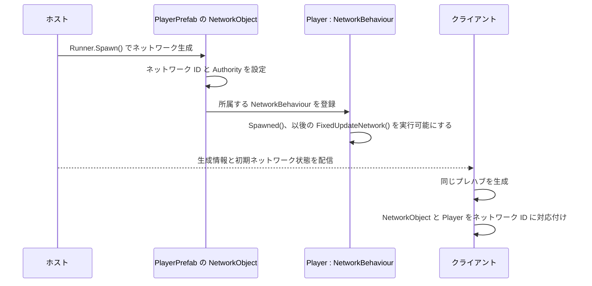
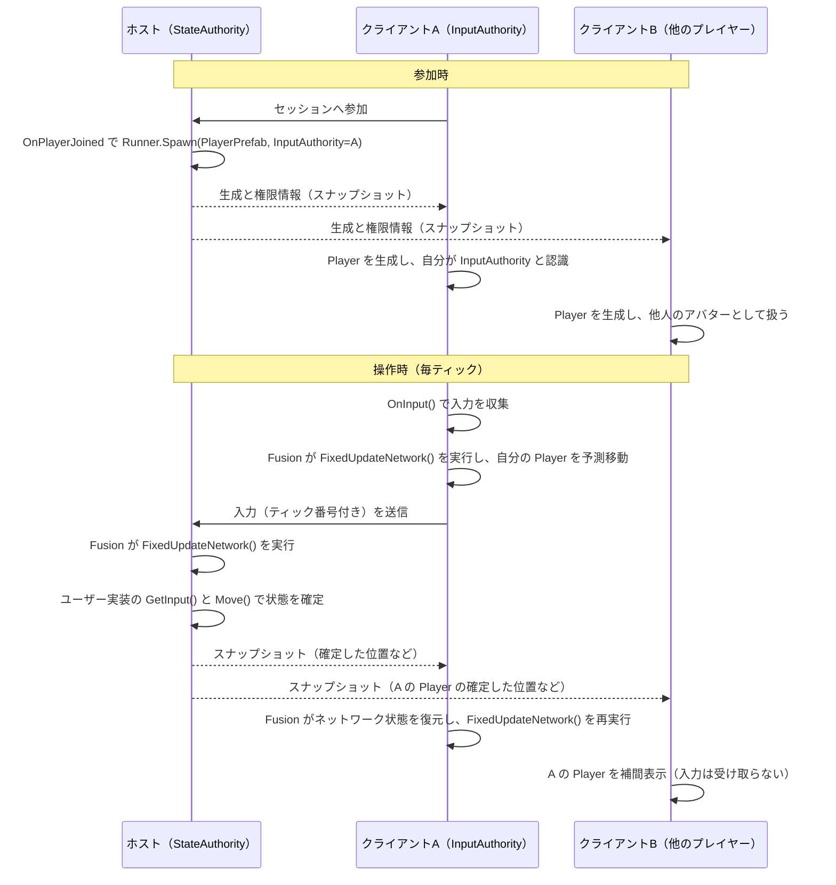
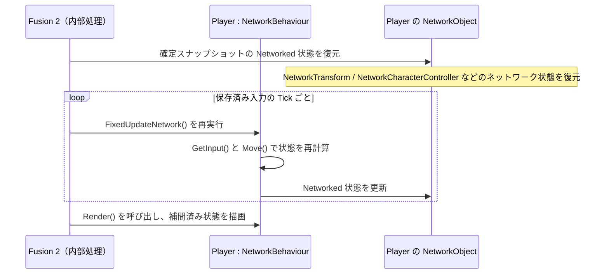
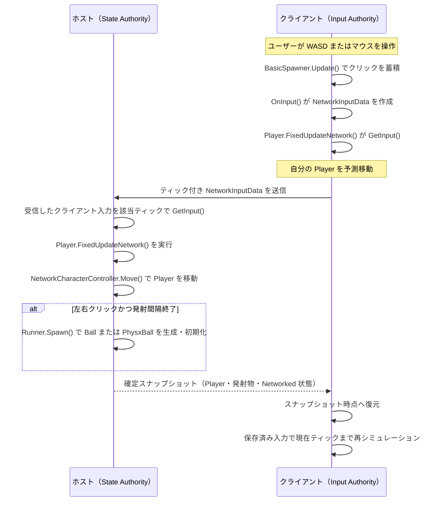

# ホストモードにおける入力共有と予測

## Player オブジェクトの解説

本節は [Fusion「2 - シーンのセットアップ」](https://doc.photonengine.com/ja-jp/fusion/v2/tutorials/host-mode-basics/2-setting-up-a-scene) を参考に、本プロジェクトの `Player`（プレイヤーアバター）が何でできていて、操作がどう全員へ伝わるかを説明します。

### 構成

`PlayerPrefab` は次のコンポーネントで構成されます。

| コンポーネント | 役割 |
| --- | --- |
| `NetworkObject` | Fusion がネットワーク上で管理するオブジェクトとして識別するための必須コンポーネント。 |
| `NetworkCharacterController` | 移動を担うコンポーネント。位置などの状態をネットワークで共有する。`CharacterController` も自動で付属する。 |
| `Player`（`NetworkBehaviour`） | 入力の取得、移動、発射物の生成を行うスクリプト。 |
| `Body`（子オブジェクト） | 見た目専用のキューブ。ネットワーク状態と見た目を分けるため、子に置く。 |

### なぜ `NetworkObject` が必要か

通常の Unity の `GameObject` は、各ピアが個別にインスタンス化するため、ピア間で「同じ物」を指す手段がありません。`NetworkObject` を付けると、次のことが可能になります。

- **ネットワーク ID の付与**: 全てのピアが同じオブジェクトを同じ ID で参照できる。
- **生成・削除の同期**: ホストが `Runner.Spawn()` / `Despawn()` すると、全てのピアで同じプレハブが生成・破棄される。プレハブは `NetworkPrefabRef` で指定され、事前に Fusion がベイクした一覧から引かれる。
- **権限の保持**: `StateAuthority`（状態を確定する側）と `InputAuthority`（入力を提供する側）を、オブジェクト単位で記録する。
- **同期状態の保存先**: `[Networked]` プロパティや `NetworkCharacterController` の状態が、`NetworkObject` を単位としてスナップショットに含まれる。
- **`NetworkBehaviour` の動作条件**: `Player` が持つ `FixedUpdateNetwork()`、`GetInput()`、`Object`、`HasStateAuthority` などは、同じ階層に `NetworkObject` があって初めて機能する。

つまり `NetworkObject` は、`Player` を「全員で共有され、権限が割り当てられるオブジェクト」にするための土台です。なお、`NetworkObject` は継承元ではなく `GameObject` に追加するコンポーネントです。ユーザーが作る `Player` のようなスクリプトは `NetworkBehaviour` を継承し、対応する `NetworkObject` と同じネットワークオブジェクトの階層に置くことで、Fusion に登録されます。

### `NetworkObject` と `NetworkBehaviour` の役割分担

`NetworkBehaviour` を継承することは、Fusion に対して「このコンポーネントはネットワーク状態と Tick 処理を持つ」と宣言することです。**生成をネットワーク上で検知・同期する役割そのものは `NetworkObject` が持ちます。** `NetworkBehaviour` だけを `GameObject` に付けても、その `GameObject` はネットワークオブジェクトにならず、Fusion は生成・権限・状態同期の対象にできません。

| コンポーネント | Fusion における責務 | 本プロジェクトの例 |
| --- | --- | --- |
| `NetworkObject` | `Runner.Spawn()` の対象となる。ネットワーク ID、State Authority、Input Authority を保持し、生成・削除・スナップショットの単位になる。関連する `NetworkBehaviour` をまとめてネットワークオブジェクトとして扱う。 | `PlayerPrefab`、`Ball`、`PhysxBall` のルート。 |
| `NetworkBehaviour` | `NetworkObject` に所属するゲームロジックを記述する。`[Networked]` プロパティ、`Spawned()`、`FixedUpdateNetwork()`、`Render()`、`GetInput()` などを使えるようにする。 | `Player`、`Ball`、`PhysxBall`。 |

ホストが `Runner.Spawn(_playerPrefab, ..., player)` を呼ぶと、Fusion は `PlayerPrefab` の `NetworkObject` をネットワーク ID と権限情報付きで生成します。その後、その `NetworkObject` に登録されている `Player : NetworkBehaviour` を有効化し、各 Tick で `FixedUpdateNetwork()`、描画時に `Render()` を呼びます。ほかのピアでは、受信した生成情報を基に同じプレハブを生成し、同じネットワーク ID を持つ `NetworkObject` と、その配下の `NetworkBehaviour` を対応付けます。

### `InputAuthority` の意味と使い方

`InputAuthority` は、そのオブジェクトを操作する入力を**提供するプレイヤー**（`PlayerRef`）です。`StateAuthority` が状態の確定者であるのに対し、`InputAuthority` は操作の発信者です。ホストモードでは、全ての `Player` の `StateAuthority` はホストにあり、`InputAuthority` はそのアバターの持ち主に設定されます。

本プロジェクトでは `BasicSpawner.OnPlayerJoined()` が、参加したプレイヤーの `PlayerRef` を指定して生成します。

`runner.Spawn(_playerPrefab, spawnPosition, Quaternion.identity, player)`

最後の引数 `player` が `InputAuthority` になります。これにより、そのプレイヤーの `OnInput()` が作る `NetworkInputData` は、他のアバターではなくこの `Player` にだけ届きます。主な使い方は次のとおりです。

- **`GetInput(out data)`**: その `NetworkObject` の `InputAuthority` に対応する入力を取得する。ホストは全プレイヤー分を取得して確定処理に使い、入力側クライアントは自分の入力を予測に使う。
- **`Object.InputAuthority`**: 発射物の生成時に渡すなどして、「誰の操作によるものか」を引き継ぐ。
- **`HasInputAuthority`**: 自分のアバターかどうかを判定する（カメラ追従や UI の出し分けなど）。

### 入力した側のクライアントの動作が全体へ伝わる流れ

クライアント A が操作した結果は、他のクライアントへ直接送られるわけではありません。**ホストを経由して**全員へ配信されます。画面上では 1 回の移動に見えても、裏では次の通信が行われています。ホストを左、クライアントを右に配置しています。

### 通信内容と Fusion が隠蔽する処理

`NetworkRunner`、`NetworkObject`、`NetworkBehaviour` を正しく設定すると、次の通信・状態管理は Fusion 2 が内部で行います。ユーザー実装はソケット通信、パケット形式、スナップショットの復元を直接扱いません。

| 方向／場所 | Fusion が自動で行うこと | ユーザー作成コンポーネントが行うこと |
| --- | --- | --- |
| クライアント → ホスト | `input.Set(data)` で渡された `INetworkInput` を Tick と対応付け、送信・再送制御・受信側での保持を行う。 | `BasicSpawner.OnInput()` がデバイス入力から `NetworkInputData` を作り、`input.Set(data)` を呼ぶ。 |
| ホストの Tick | `NetworkObject` ごとに権限と入力を関連付け、ネットワークシミュレーションを進める。 | `Player.FixedUpdateNetwork()` が `GetInput()`、`NetworkCharacterController.Move()`、`Runner.Spawn()` などを実行してゲーム固有の状態を計算する。 |
| ホスト → 全クライアント | 生成・削除、`[Networked]` プロパティ、`NetworkTransform` などのネットワークコンポーネントの状態からスナップショットを作り、差分圧縮して配信する。 | `[Networked]` とネットワークコンポーネントを使い、同期すべきゲーム状態を宣言する。パケット送信はしない。 |
| クライアントの受信 | スナップショットに含まれる `NetworkObject` のネットワーク状態を復元し、描画用に補間する。入力の処理済み Tick などプロトコル上の情報も Fusion 内部で扱う。 | `Render()` を実装して、補間済み状態を基に見た目・UI・音などを更新できる。 |
| クライアントの再シミュレーション | 確定スナップショットの Tick にネットワーク状態を戻し、保存済み入力を用いて現在の予測 Tick までシミュレーションを再実行する。 | Fusion が再度呼ぶ `FixedUpdateNetwork()` では、同じ入力とネットワーク状態から同じ結果を計算する。 |

`INetworkRunnerCallbacks` の `OnPlayerJoined()`、`OnPlayerLeft()`、`OnInput()`、`OnInputMissing()` は、Fusion からユーザー実装へ通知されるコールバックです。一方、スナップショット受信や再シミュレーションの開始・終了に対応して、毎回ユーザーが受け取る専用の通知を実装する必要はありません。Fusion が `NetworkBehaviour` の `FixedUpdateNetwork()` と `Render()` を適切なタイミングで呼び出します。

### 再シミュレーションで戻る状態と再実行される処理

質問の解釈は概ね正しいですが、「GameObject 全体を戻す」とすると範囲が広すぎます。Fusion が `NetworkObject` を単位に復元するのは、`[Networked]` プロパティと `NetworkTransform`・`NetworkCharacterController` などの**ネットワーク化された状態**です。通常のフィールド、Unity の静的変数、直接変更した非ネットワークの `GameObject` 状態は自動では巻き戻りません。

復元後、Fusion は過去の入力を使い、該当する `NetworkBehaviour.FixedUpdateNetwork()` を現在の予測 Tick まで再度呼び出します。したがって `Player`、`Ball`、`PhysxBall` などのユーザー作成コンポーネントにある Tick 処理は再実行されます。再シミュレーションで同一 Tick が複数回実行されても破綻しないよう、`FixedUpdateNetwork()` 内ではネットワーク状態と入力から状態を再計算します。見た目・効果音・ログのように繰り返してはならないローカル副作用は、`Render()` で処理するか、再シミュレーション中であることを判定して抑制します。

クライアント B は A の入力を受け取りません。ホストが確定した位置をスナップショットで受け取り、前後の状態を補間して表示します。そのため B から見た A の動きは、A 本人の画面より少し遅れます。一方 A 本人は、`InputAuthority` を持つ自分の `Player` を予測移動できるので、遅延を感じずに操作できます。

---

このプロジェクトは Photon Fusion

本書は [Fusion の「3 - 予測」](https://doc.photonengine.com/ja-jp/fusion/v2/tutorials/host-mode-basics/3-prediction) と、現在のプロジェクトの実装を対応付けて説明します。

## 登場するオブジェクトと責務

| オブジェクト | 役割 |
| --- | --- |
| `BasicSpawner` | `NetworkRunner` を作成し、`OnInput()` でキーボード・マウスの生入力を `NetworkInputData` に詰める。ホストでは参加時の `Player` の生成も行う。 |
| `NetworkInputData` | ティック単位で共有する入力データ。`Direction` に WASD の移動方向、`Buttons` に左右マウスボタンの押下を格納する。 |
| `Player` | 各プレイヤーのアバター。`GetInput()` で自分に対応する入力を取得し、移動をシミュレーションする。ホスト上では発射物も生成する。 |
| `NetworkCharacterController` | `Player` に付属する移動コンポーネント。`Player.FixedUpdateNetwork()` から `Move()` を呼ばれ、アバターの位置に作用する。 |
| `Ball` / `PhysxBall` | ホストが生成する発射物。`Ball` はキネマティックに直進し、`PhysxBall` は `Rigidbody.linearVelocity` に初速を与える。どちらも寿命終了時にホストが削除する。 |

`BasicSpawner.StartGame()` は `NetworkRunner.ProvideInput = true` を設定します。この設定により、Fusion は各シミュレーションティックで `INetworkRunnerCallbacks.OnInput()` を呼び出し、そのピアが提供する入力を収集します。

## ユーザー入力が伝わる経路

`BasicSpawner.Update()` は毎フレーム、左クリックと右クリックを `_mouseButton0` / `_mouseButton1` に蓄積します。短いクリックが `OnInput()` の呼び出し間隔に収まっても失われないよう、押下を一度記録してから入力データに移し、フラグをリセットしています。

`OnInput()` では次の値を `NetworkInputData` に格納し、`input.Set(data)` で Fusion に渡します。

- **WASD**: `Direction` に前後左右のベクトルを加算する。
- **左クリック**: `Buttons` の `MouseButton0` ビットを立てる。
- **右クリック**: `Buttons` の `MouseButton1` ビットを立てる。

Fusion はこの入力をティックと対応付けます。クライアントが作った入力はホストへ送られ、ホストはそのティックをシミュレーションするときに同じ入力を取り出します。ホスト自身の入力も同じ `OnInput()` → `NetworkInputData` → `GetInput()` の経路を通るため、ゲームロジックは「ローカル操作かリモート操作か」を分岐せずに扱えます。

## ホストとクライアントの通信シーケンス

次の図では、ホストを左、クライアントを右に配置しています。`Player` の移動はクライアントで予測されますが、ネットワーク上の確定状態と `Ball` / `PhysxBall` の生成はホストが担当します。

## `Player` に作用する入力

`Player.FixedUpdateNetwork()` は `GetInput(out NetworkInputData data)` に成功した場合だけ、そのティックの入力を使います。`Direction` は正規化された後、次の形で `NetworkCharacterController` に渡されます。

`_cc.Move(MoveSpeed * data.Direction * Runner.DeltaTime)`

つまり、WASD は **入力を送ったプレイヤーの `Player` オブジェクト**に付属する `NetworkCharacterController` の移動に作用します。移動方向がゼロでなければ `_forward` に保存され、後の発射方向にも使用されます。

予測がホストの結果と異なれば、この再シミュレーションによって表示が確定状態へ収束します。

予測の対象は、そのクライアントが `InputAuthority` を持つ `Player` です。自分が発射した `Ball` のスポーン自体は予測されず、ホストが生成を確定してから全ピアへ配信されます。

他プレイヤーの `Player` は、ホストの確定スナップショットを基準に表示されます。入力そのものは他クライアントへ配信されないため、他プレイヤーの移動をローカルで先行して再現することはできません。`NetworkCharacterController` を含むネットワーク化された状態がスナップショットで更新され、Fusion の補間によって画面に表示されます。このため、他プレイヤーはホストの状態同期に依存し、本人の画面より少し遅れて見えます。

ただし、他プレイヤーの `NetworkObject` がクライアントに存在する間は、その `Player.FixedUpdateNetwork()` 自体は Fusion によって Tick ごとに呼び出されます。このプロジェクトの `Player` は最初に `GetInput(out NetworkInputData data)` を判定しているため、他プレイヤーの入力を持たないクライアントでは `GetInput()` が `false` になり、メソッド本体の移動・`_forward` 更新・発射判定は実行されません。したがって、他プレイヤーの `Player` に対してローカルコードが独自に位置を進めることはなく、位置はホストから復元されたネットワーク状態に従います。

一方、ホストでは全 `Player` の入力を取得できるため、各 `Player.FixedUpdateNetwork()` の `GetInput()` が成功し、それぞれの移動を確定できます。また、発射処理は `HasStateAuthority` が真のホストでのみ実行されるため、クライアントでは予測されません。

## マウス入力と発射物

クリックを受け取った `Player` は、まず `_delay`（`TickTimer`）で 0.5 秒の発射間隔を確認します。ただし、発射処理は `HasStateAuthority` が真のとき、すなわちホスト上でのみ実行されます。

- **左クリック**: `Runner.Spawn()` で `Ball` を生成する。`Ball.Init()` が 5 秒の寿命を設定し、`Ball.FixedUpdateNetwork()` が `transform.position` を前方へ進める。
- **右クリック**: `Runner.Spawn()` で `PhysxBall` を生成する。`PhysxBall.Init()` が前方ベクトルに `BallSpeed` を掛け、`Rigidbody.linearVelocity` に設定する。

生成時には操作したプレイヤーの `Object.InputAuthority` も発射物へ渡されます。しかし、生成を許可するのは State Authority だけです。そのため、クライアントがクリックした場合でも、クライアント自身が発射物を確定生成するわけではありません。入力がホストに到着し、ホストの `Player.FixedUpdateNetwork()` が `Runner.Spawn()` を実行して初めて発射物がネットワークオブジェクトになります。その生成結果・位置・寿命はスナップショットで全ピアに配信されます。

このように、**入力は各ユーザーが提供し、応答性はクライアント予測で確保し、最終的な状態とオブジェクト生成はホストが確定する**ことで、ホストモードの通信と整合性が成立しています。