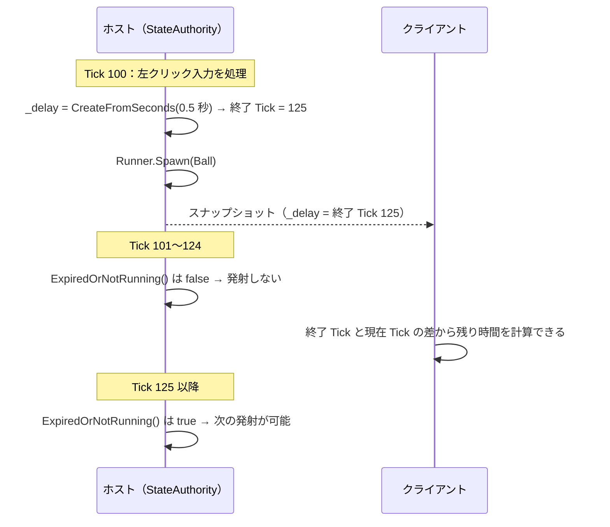
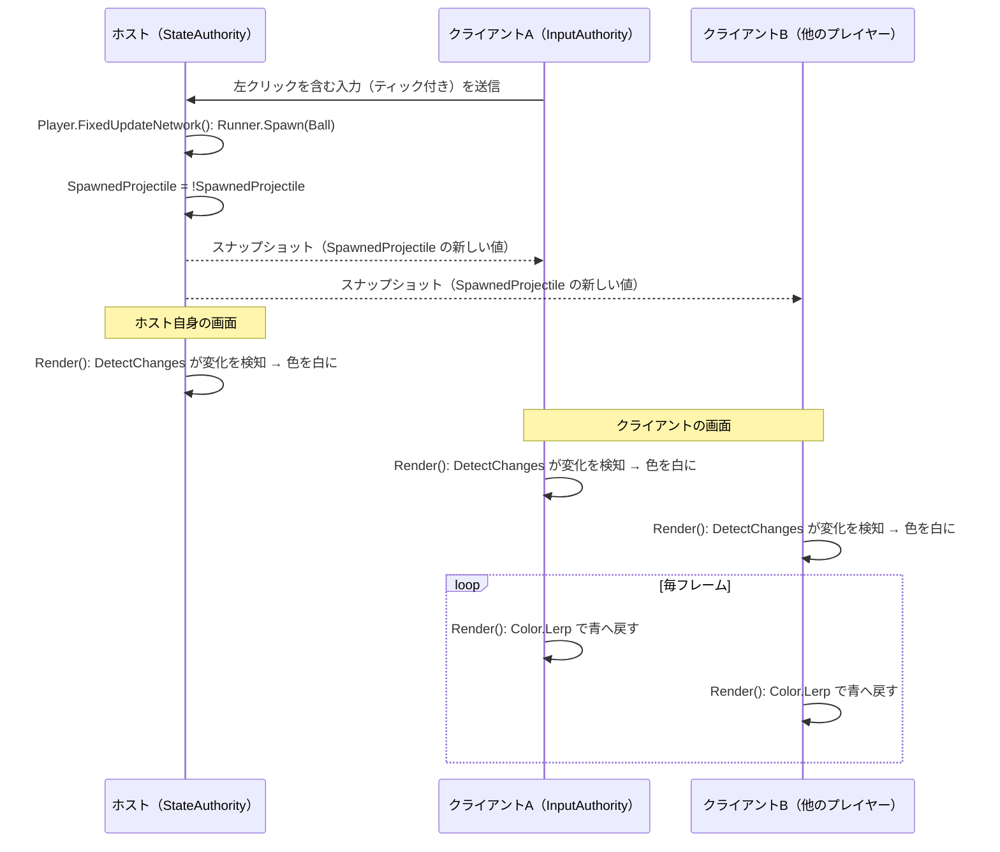
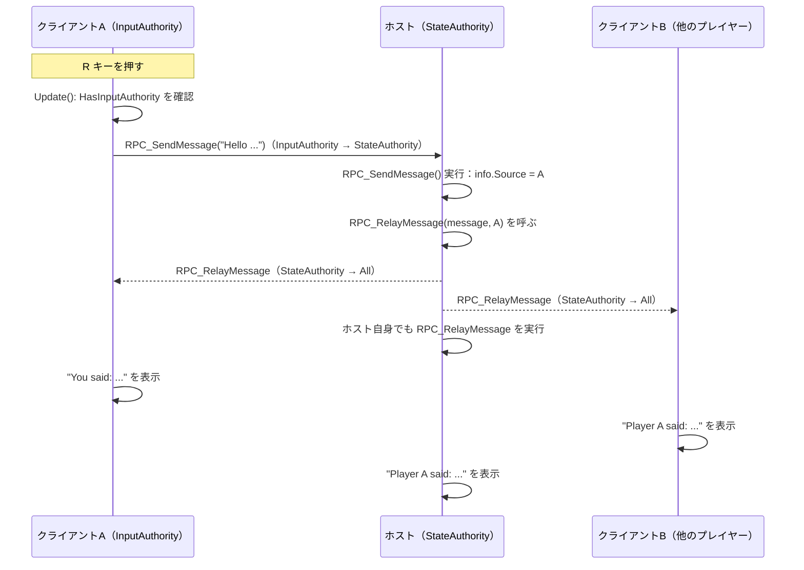
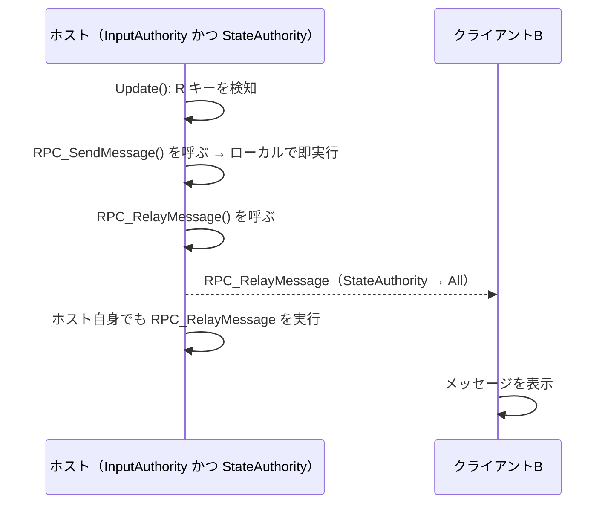
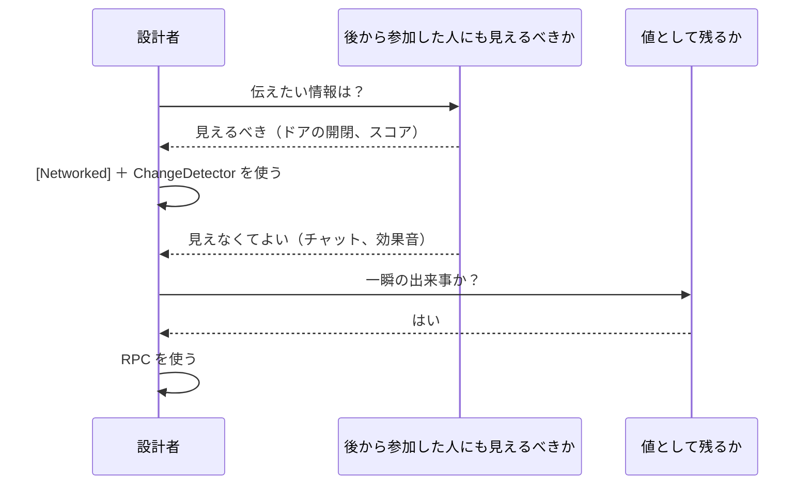

# ホストモードにおける入力共有と予測（続2）プロパティの変更・RPC

本書は `Docs/ホストモードにおける入力共有と予測（続）Ball・物理・NetworkInputData.md` の続編です。Fusion チュートリアルの [5 - プロパティの変更と RPC](https://doc.photonengine.com/ja-jp/fusion/v2/tutorials/host-mode-basics/5-property-changes-and-rpcs) の内容を、本プロジェクトのスクリプト（`Player`、`BasicSpawner`）に対応付けて説明します。

前回までに、入力（`NetworkInputData`）がホストへ送られ、ホストが確定した状態がスナップショットで全員へ配信されることを説明しました。今回は次の 2 点を扱います。

- **プロパティの変更検知**: `[Networked]` プロパティが変わった「瞬間」を `ChangeDetector` で検知し、見た目や効果音に反映する。
- **RPC（Remote Procedure Call）**: 状態ではなく「出来事（イベント）」を、指定したピアへ届ける。

## 0. 前提となる知識の整理

### 0.1 状態の同期とイベントの通知

ネットワークで共有したい情報は、大きく 2 種類に分けられます。

| 種類 | 例 | 向いている仕組み |
| --- | --- | --- |
| 状態（State） | 位置、体力、スコア、発射済みかどうか | `[Networked]` プロパティ、`NetworkTransform` |
| イベント（Event） | 「メッセージを送った」「爆発した」「効果音を鳴らす」 | RPC、または `[Networked]` の変更検知 |

状態はスナップショットに含まれるため、**後から参加したピアにも現在の値が届きます**。一方、イベントは「その瞬間」にだけ意味があり、過ぎ去った出来事は後から参加したピアには届きません。この性質の違いが、今回の設計判断の基準になります。

### 0.2 前回までに登場した Tick 関連の復習

| 用語 | 意味 |
| --- | --- |
| `FixedUpdateNetwork()` | Tick ごとに呼ばれる。再シミュレーションで同じ Tick が複数回呼ばれることがある。 |
| `Render()` | 描画フレームごとに呼ばれる。補間済みの状態を使って見た目を更新する場所。 |
| `TickTimer` | 「終了する Tick」を保存するタイマー。Tick 番号だけを同期すればよい。 |
| `HasStateAuthority` | 状態の確定者（ホスト）かどうか。 |
| `HasInputAuthority` | そのオブジェクトの操作者（持ち主）かどうか。 |

## 1. TickTimer の復習と `_delay` の同期

### 1.1 現在の定義

`Player` は発射間隔の管理に `TickTimer` を使っています。

```csharp
[Networked]
private TickTimer _delay { get; set; }
```

使用箇所は `FixedUpdateNetwork()` の次の部分です。

```csharp
if (HasStateAuthority && _delay.ExpiredOrNotRunning(Runner))
{
	if (data.Buttons.IsSet(NetworkInputData.MouseButton0))
	{
		_delay = TickTimer.CreateFromSeconds(Runner, ShootDelay);
		// ... Runner.Spawn(...)
	}
}
```

### 1.2 TickTimer が同期管理に向いている理由

| 項目 | 内容 |
| --- | --- |
| 保持する値 | 「何 Tick 目に終了するか」という整数（終了 Tick）。 |
| 同期されるタイミング | `CreateFromSeconds()` で代入した時の 1 回だけ。毎 Tick の残り時間は送らない。 |
| 残り時間の取得 | 現在の Tick と終了 Tick の差から、各ピアが計算する。 |
| 主なメソッド | `ExpiredOrNotRunning(Runner)`、`Expired(Runner)`、`RemainingTime(Runner)`、`IsRunning` |

毎フレーム「残り 0.3 秒」「残り 0.29 秒」と送る方式と比べて、通信量が小さくなります。また、再シミュレーションで Tick が巻き戻っても、終了 Tick は変わらないため、結果が一貫します。

### 1.3 `Expired` と `ExpiredOrNotRunning` の違い

| メソッド | タイマーが未開始（既定値）の場合 | 終了 Tick を過ぎた場合 |
| --- | --- | --- |
| `Expired(Runner)` | `false` | `true` |
| `ExpiredOrNotRunning(Runner)` | `true` | `true` |

`Ball` の `_life` は `Init()` で必ず開始されるため `Expired()` を使います。`Player` の `_delay` は、最初の 1 発目を撃つ時点ではまだ開始されていないため、`ExpiredOrNotRunning()` を使います。



## 2. プロパティの変更検知（ChangeDetector）

### 2.1 解決したい課題

`[Networked]` プロパティは、値そのものはスナップショットで全ピアに届きます。しかし、**「値が変わった瞬間に 1 回だけ何かをする」処理は自動では行われません**。たとえば次のような処理です。

- 発射した瞬間にアバターを白く光らせる。
- 体力が減った瞬間にダメージ音を鳴らす。
- ドアの開閉フラグが変わった瞬間にアニメーションを再生する。

`Render()` は毎フレーム呼ばれるため、値を比較して「前回と違う」ことを自分で判定する必要があります。この比較を Fusion が代行する仕組みが `ChangeDetector` です。

### 2.2 本プロジェクトでの実装

`Player` には、発射した瞬間にアバターの色を変える処理が実装されています。

```csharp
[Networked]
public bool SpawnedProjectile { get; set; }
private ChangeDetector _changeDetector;

public override void Spawned()
{
	_changeDetector = GetChangeDetector(ChangeDetector.Source.SimulationState);
}

public override void Render()
{
	foreach (var change in _changeDetector.DetectChanges(this))
	{
		switch (change)
		{
			case nameof(SpawnedProjectile):
				_material.color = Color.white;
				break;
		}
	}
	_material.color = Color.Lerp(_material.color, Color.blue, Time.deltaTime);
}
```

また、ホスト上の `FixedUpdateNetwork()` で発射の度に値を反転しています。

```csharp
SpawnedProjectile = !SpawnedProjectile;
```

### 2.3 各要素の役割

| 要素 | 役割 |
| --- | --- |
| `[Networked] bool SpawnedProjectile` | 変化を通知するための「合図」。値の true / false 自体に意味はなく、**反転した事実**が重要。 |
| `GetChangeDetector(...)` | `Spawned()` で 1 度だけ取得する。取得した時点の状態が比較の基準になる。 |
| `DetectChanges(this)` | 前回の呼び出し以降に変化した `[Networked]` プロパティ名を列挙する。 |
| `nameof(SpawnedProjectile)` | 変化したプロパティ名を、文字列の直書きなしで判定する。 |
| `Render()` 内での処理 | 見た目の更新は `Render()` で行う。`FixedUpdateNetwork()` は再シミュレーションで複数回呼ばれるため、見た目の処理には向かない。 |

`bool` を反転させる方式を使うのは、「撃つたびに必ず値が変わる」ようにするためです。常に `true` を代入すると、2 発目以降は値が変わらず、変更として検知されません。

### 2.4 `Source` の種類

`GetChangeDetector()` の引数で、どの時点の状態を比較するかを選べます。

| `ChangeDetector.Source` | 比較対象 | 主な用途 |
| --- | --- | --- |
| `SimulationState` | シミュレーション中の現在の状態。予測を含む。 | 入力した本人の画面で、予測に基づく反応をしたい場合。 |
| `SnapshotFrom` | 補間に使う 2 つのスナップショットのうち、古い方。 | 補間表示と同じタイミングで反応したい場合。 |
| `SnapshotTo` | 補間に使う 2 つのスナップショットのうち、新しい方。 | 同上。 |

本プロジェクトの `Player` は `SimulationState` を使っています。なお、`SpawnedProjectile` を書き換えるのはホストだけで、クライアントはスナップショットで受け取った値を基に変化を検知します。

### 2.5 変更前後の値の取得

「何から何に変わったか」を知りたい場合は、`DetectChanges` の `out` 引数と `GetPropertyReader` を使います。

```csharp
foreach (var change in _changeDetector.DetectChanges(this, out var previousBuffer, out var currentBuffer))
{
	switch (change)
	{
		case nameof(SpawnedProjectile):
			var reader = GetPropertyReader<bool>(nameof(SpawnedProjectile));
			var (previous, current) = reader.Read(previousBuffer, currentBuffer);
			Debug.Log($"SpawnedProjectile: {previous} → {current}");
			break;
	}
}
```

体力の減少量に応じてダメージ表示の大きさを変える、といった用途で使えます。

### 2.6 ホストとクライアントでの流れ



この仕組みでは、ホストが状態を 1 回書き換えるだけで、全てのピアが自分の `Render()` で変化に反応します。通信の内容は「状態の差分」だけで、「色を変えろ」という命令は送られていません。

### 2.7 注意点

| 注意点 | 理由 |
| --- | --- |
| 見た目・音の処理は `Render()` で行う | `FixedUpdateNetwork()` は再シミュレーションで同じ Tick が複数回呼ばれ、音が重複して鳴る。 |
| `GetChangeDetector()` は `Spawned()` で取得する | 取得した時点の状態が基準になる。スポーン前に取得しても有効な状態が無い。 |
| `Awake()` で取得したマテリアルは `.material` | `.material` はインスタンスを複製する。プレイヤーごとに色を変えられる。ただし破棄は自分で管理する必要がある。 |
| 変化が 2 回連続で起きた場合 | 間に `Render()` が呼ばれなければ、1 回の変化としてまとめて検知される。 |

## 3. RPC（Remote Procedure Call）

### 3.1 RPC とは

RPC は、**あるピアでメソッドを呼ぶと、別のピアで同じメソッドが実行される**仕組みです。`[Networked]` プロパティが「状態を共有する」仕組みであるのに対し、RPC は「出来事を伝える」仕組みです。

Fusion では、`NetworkBehaviour` 内のメソッドに `[Rpc]` 属性を付けて宣言します。呼び出しの通信は Fusion が処理し、ユーザー実装はソケットやパケットを扱いません。

```csharp
[Rpc(RpcSources.InputAuthority, RpcTargets.StateAuthority)]
public void RPC_SendMessage(string message, RpcInfo info = default)
{
	// ホスト側で実行される
}
```

### 3.2 `[Rpc]` 属性の 2 つの引数

| 引数 | 意味 | 主な値 |
| --- | --- | --- |
| `RpcSources` | **誰が**このメソッドを呼べるか。 | `InputAuthority`、`StateAuthority`、`Proxies`、`All` |
| `RpcTargets` | **どこで**このメソッドが実行されるか。 | `StateAuthority`、`InputAuthority`、`Proxies`、`All` |

ホストモードでの典型的な組み合わせは次のとおりです。

| 組み合わせ | 用途 |
| --- | --- |
| `InputAuthority` → `StateAuthority` | クライアントからホストへの依頼。「これをやってほしい」。 |
| `StateAuthority` → `All` | ホストから全員への通知。「これが起きた」。 |
| `StateAuthority` → `InputAuthority` | ホストから特定のプレイヤー 1 人への通知。 |

ホストモードでは、クライアント同士は直接通信しないため、クライアントから他のクライアントへ伝える場合は、**ホストを経由する 2 段階の RPC** にするのが基本です。

### 3.3 RpcInfo と呼び出し元の取得

メソッドの最後の引数に `RpcInfo info = default` を付けると、呼び出しに関する情報を受け取れます。

| プロパティ | 内容 |
| --- | --- |
| `info.Source` | 呼び出したプレイヤーの `PlayerRef`。 |
| `info.Tick` | 呼び出された Tick。 |
| `info.Channel` | 使用された通信チャネル（信頼性あり／なし）。 |

`RpcInfo` はユーザーが引数に渡す値ではなく、Fusion が自動で設定します。呼び出し側のコードでは省略できます。

### 3.4 RPC の制約

| 項目 | 内容 |
| --- | --- |
| 宣言できる場所 | `NetworkBehaviour` を継承したクラス。`NetworkObject` が存在する階層に置く。 |
| 戻り値 | 返せない。非同期の応答が必要なら、別の RPC で返す。 |
| 引数に使える型 | `int`、`float`、`bool`、`Vector3`、`PlayerRef`、`NetworkId`、固定長の文字列など、Fusion がシリアライズできる型。 |
| データ量 | 1 回の RPC のデータサイズには上限がある。大きなデータの送信には向かない。 |
| 命名 | `RPC_` で始める命名が慣例。一目で RPC と分かる。 |
| 実行の保証 | 既定では信頼性のあるチャネルで送られ、順序も保たれる。 |

文字列を引数にすると、文字数に応じて通信量が増えます。頻繁に呼ぶ RPC では、文字列ではなく `int` の ID を送り、受信側で文字列に変換する設計が望ましいです。

### 3.5 本プロジェクトへの適用：メッセージ送信

チュートリアルの題材にならい、**R キーを押すと、全員の画面にメッセージが表示される**機能を追加します。流れは次のとおりです。

1. 入力した本人（`InputAuthority`）が R キーを押す。
2. `RPC_SendMessage()` で、ホストへメッセージを依頼する。
3. ホストが `RPC_RelayMessage()` で、全員へメッセージを配信する。
4. 各ピアが画面にメッセージを表示する。

#### 3.5.1 Player への追加

`using UnityEngine.InputSystem;` を追加し、`Player` クラスに次のメソッドを追加します。

```csharp
private void Update()
{
	if (HasInputAuthority && (Keyboard.current?.rKey.wasPressedThisFrame ?? false))
	{
		RPC_SendMessage($"Hello from Player {Object.InputAuthority.PlayerId}");
	}
}

[Rpc(RpcSources.InputAuthority, RpcTargets.StateAuthority)]
public void RPC_SendMessage(string message, RpcInfo info = default)
{
	// ホスト上で実行される。呼び出し元（info.Source）を付けて全員へ中継する
	RPC_RelayMessage(message, info.Source);
}

[Rpc(RpcSources.StateAuthority, RpcTargets.All)]
public void RPC_RelayMessage(string message, PlayerRef messageSource)
{
	// 全てのピアで実行される
	string text = messageSource == Runner.LocalPlayer
		? $"You said: {message}"
		: $"Player {messageSource.PlayerId} said: {message}";

	Runner.GetComponent<BasicSpawner>().ShowMessage(text);
}
```

`Runner` は `BasicSpawner` と同じ `GameObject` に `AddComponent<NetworkRunner>()` で追加されているため、`Runner.GetComponent<BasicSpawner>()` で取得できます。

#### 3.5.2 BasicSpawner への追加

メッセージを一定時間画面に表示する処理を追加します。TextMeshPro を使わず、既存の `OnGUI()` に合わせます。

```csharp
private string _message = "";
private float _messageUntil;

public void ShowMessage(string message)
{
	_message = message;
	_messageUntil = Time.time + 3f;
}
```

既存の `OnGUI()` の末尾に、次の処理を足します。

```csharp
if (Time.time < _messageUntil)
{
	GUI.Label(new Rect(0, 90, 600, 30), _message);
}
```

### 3.6 メッセージ送信のシーケンス



クライアント A が送った内容は、ホストを経由して A 自身にも戻ってきます。そのため `messageSource == Runner.LocalPlayer` で自分の発言かどうかを判定し、表示を切り替えています。

### 3.7 ホストが自分のアバターで呼び出した場合

ホストのプレイヤーは、`InputAuthority` と `StateAuthority` の両方を持っています。この場合、`RPC_SendMessage()` を呼ぶと、通信を介さずにその場で実行されます。



ゲームロジックは、呼び出し元がホストかクライアントかを分岐せずに書けます。これは入力処理（`OnInput()` → `GetInput()`）と同じ設計思想です。

## 4. Update と FixedUpdateNetwork のどちらで RPC を呼ぶか

| 場所 | 特徴 | 本機能での判断 |
| --- | --- | --- |
| `Update()` | 描画フレームごとに呼ばれる。Unity のキー入力をそのまま扱える。 | キー入力の瞬間（`wasPressedThisFrame`）を逃さないため、こちらを使う。 |
| `FixedUpdateNetwork()` | Tick ごとに呼ばれる。再シミュレーションで同じ Tick が複数回実行される。 | 入力は `NetworkInputData` 経由でなければ取得できない。RPC の呼び出し元には不向き。 |

`Update()` から呼ぶ場合は、`HasInputAuthority` で「自分のアバターか」を必ず確認します。この確認が無いと、全ピアが全てのアバターの `Update()` で RPC を呼んでしまいます。

また、ゲームの状態を変える処理（発射、ダメージなど）は、入力として `NetworkInputData` に載せ、`FixedUpdateNetwork()` で処理するのが基本です。RPC は、入力の仕組みに載せにくい単発のイベント（チャット、スコア表示の通知など）に使います。

## 5. `[Networked]` の変更検知と RPC の使い分け

同じ「全員に何かを伝える」目的でも、2 つの仕組みには性質の違いがあります。

| 観点 | `[Networked]` ＋ `ChangeDetector` | RPC |
| --- | --- | --- |
| 伝えるもの | 状態（値） | 出来事（呼び出し） |
| 後から参加したピア | 現在の値を受け取る | 過去の呼び出しは受け取れない |
| 再接続・復元 | スナップショットから復元できる | 復元できない |
| 通信のタイミング | スナップショットに乗って配信される | 呼び出しごとに送られる |
| 任意の引数 | 値として保持できる範囲のみ | 引数で自由に渡せる |
| 呼び出し元の識別 | `StateAuthority` が書く前提 | `RpcInfo.Source` で取得できる |
| 本プロジェクトでの例 | `SpawnedProjectile` による発射の合図 | `RPC_SendMessage` によるメッセージ |

### 5.1 判断の目安



迷った場合は、「この情報は、1 分後に参加したプレイヤーにも必要か」を考えます。必要なら `[Networked]`、不要なら RPC です。

本プロジェクトの発射の合図（`SpawnedProjectile`）は、「撃った瞬間」というイベントですが、RPC ではなく `[Networked]` ＋ `ChangeDetector` で実装されています。これは、アバターの色変化が `Render()` の補間と同じ時間軸で動くこと、および RPC の送信回数を増やさないことを優先した設計です。RPC でも実現できますが、その場合は発射の Tick と表示のタイミングがずれる可能性があります。

## 6. 動作確認の手順

### 6.1 複数プレイヤーでの確認

Unity 6 の Multiplayer Play Mode（`com.unity.multiplayer.playmode`）を使うと、1 つのエディタで複数のインスタンスを起動できます。

| 手順 | 確認内容 |
| --- | --- |
| 1 | メインのエディタで `Host` ボタンを押す。 |
| 2 | 仮想プレイヤーで `Join` ボタンを押す。 |
| 3 | どちらかの画面で左クリックし、**全ての画面で**発射したプレイヤーのアバターが白く光ることを確認する。 |
| 4 | クライアント側で R キーを押し、**全ての画面に**メッセージが表示されることを確認する。 |
| 5 | ホスト側で R キーを押し、同様に全員に表示されることを確認する。 |

### 6.2 うまく動かない場合の確認点

| 症状 | 確認すること |
| --- | --- |
| 色が変わらない | `Spawned()` で `GetChangeDetector()` を呼んでいるか。`SpawnedProjectile` を **ホスト側**で反転しているか。 |
| 色が最初から青のまま白にならない | `Render()` の `Color.Lerp` が、検知した直後の白をすぐ上書きしていないか（1 フレームだけ白になり、すぐ青へ向かうのは仕様）。 |
| R キーを押しても何も起きない | `HasInputAuthority` が `true` のアバターで押しているか。`BasicSpawner` が `Runner` と同じ `GameObject` にあるか。 |
| 全員に 2 回表示される | `Update()` で `HasInputAuthority` を確認しているか。他のアバターの `Update()` でも RPC が呼ばれていないか。 |
| RPC のコンパイルエラー | `[Rpc]` を付けたメソッドが、`NetworkBehaviour` の中にあるか。Fusion のウィーバー（`FUSION_WEAVER`）が有効か。 |
| クライアントの RPC が実行されない | `RpcSources` が呼び出し元の権限と一致しているか（`InputAuthority` を持たないアバターからは呼べない）。 |

## 7. 全体のまとめ

1. 状態の変化は、ホストが `[Networked]` プロパティを書き換え、スナップショットで全員へ届く。各ピアは `Render()` 内の `ChangeDetector` で「変わった瞬間」を検知し、見た目や音に反映する。
2. `TickTimer` は「終了 Tick」だけを同期するため、通信量が小さく、再シミュレーションでも結果が一貫する。`_delay` と `Ball` の `_life` が実例である。
3. RPC は、メソッド呼び出しを別のピアへ届ける仕組みである。`RpcSources` で呼び出せる側を、`RpcTargets` で実行される側を指定する。
4. ホストモードでは、クライアント同士は直接通信しない。クライアントから全員へ伝える場合は、**クライアント → ホスト → 全員**の 2 段階の RPC にする。
5. `[Networked]` は後から参加したピアにも現在の値が届き、RPC は届かない。「後から参加した人にも必要か」が使い分けの基準である。
6. 見た目・音などの副作用は `Render()` で処理する。ゲームの状態を変える処理は、入力（`NetworkInputData`）と `FixedUpdateNetwork()` の流れに載せる。

## 8. 課題

| 課題 | 内容 |
| --- | --- |
| 基本 | R キーのメッセージを、固定文字列ではなく、`int` の ID から選んだ定型文（「こんにちは」「ナイス」など）に変更する。通信量の観点で、文字列と ID の違いを説明する。 |
| 応用 | 右クリックで `PhysxBall` を撃った場合は、`SpawnedProjectile` とは別の `[Networked]` プロパティを追加し、アバターを白ではなく赤く光らせる。 |
| 発展 | `StateAuthority` → `InputAuthority` の RPC を追加し、自分が撃った弾が発射された時にだけ、自分の画面に「発射した」と表示する。 |