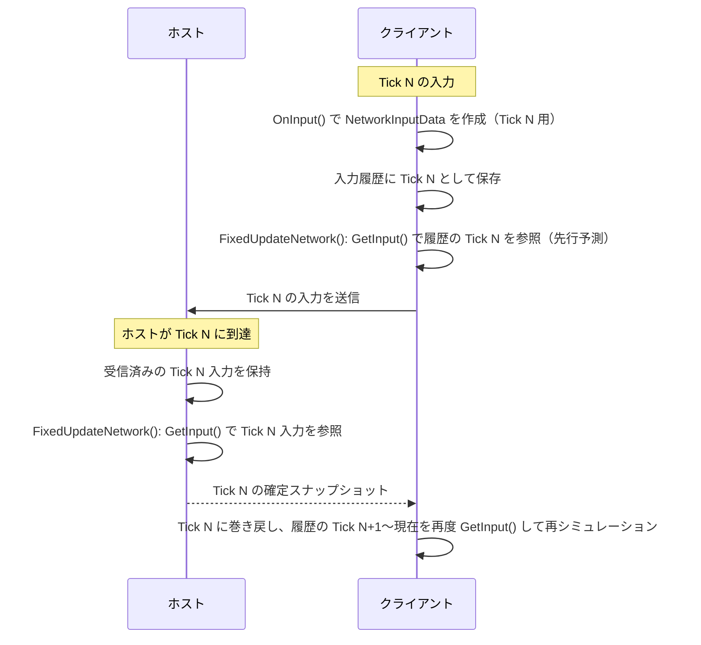
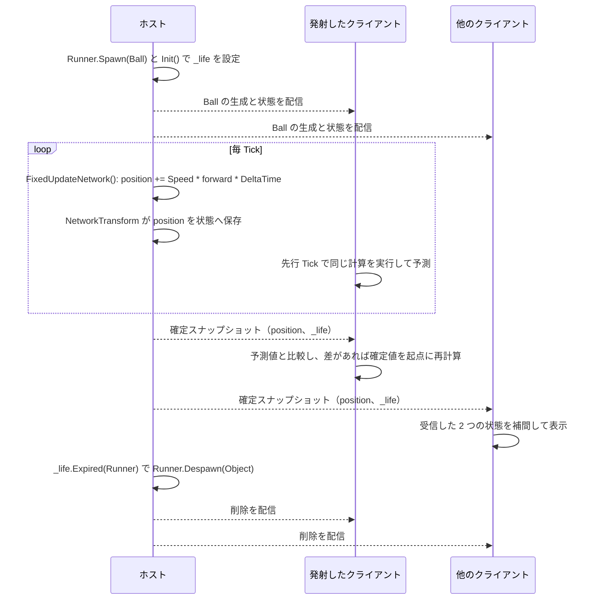
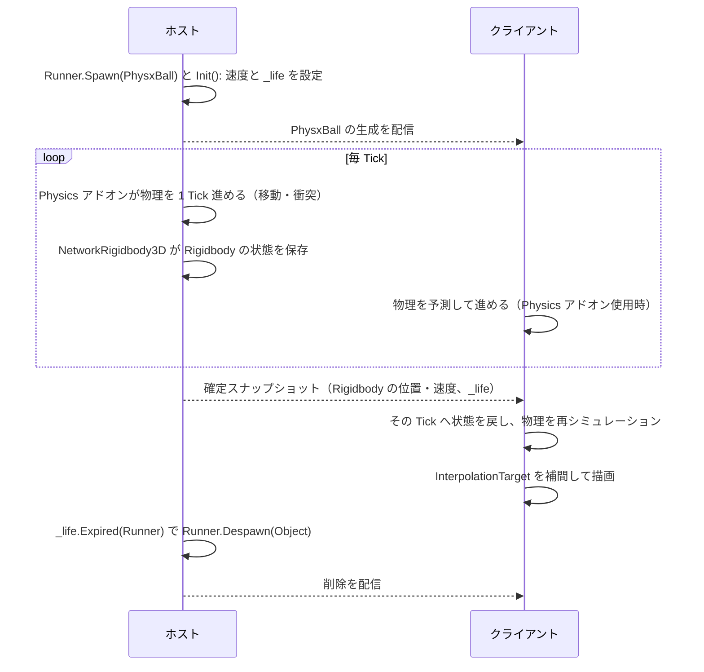

# ホストモードにおける入力共有と予測（続）Ball・PhysxBall・NetworkInputData

本書は `Docs/# ホストモードにおける入力共有と予測.md` の続編です。Fusion チュートリアルの [3 - 予測](https://doc.photonengine.com/ja-jp/fusion/v2/tutorials/host-mode-basics/3-prediction) と [4 - 物理](https://doc.photonengine.com/ja-jp/fusion/v2/tutorials/host-mode-basics/4-physics) の内容を、本プロジェクトのスクリプト（`NetworkInputData`、`Ball`、`PhysxBall`）に対応付けて説明します。

## 0. 前提となる Tick の知識

Fusion のシミュレーションは時間ではなく **Tick（ティック）** という整数の刻みで進みます。

| 用語 | 意味 |
| --- | --- |
| Tick | シミュレーションの 1 ステップ。`Runner.Tick` で現在値を取得できる。 |
| `Runner.DeltaTime` | 1 Tick の長さ（秒）。`Time.deltaTime` の代わりに使う。 |
| `FixedUpdateNetwork()` | Tick ごとに呼ばれる。Unity の `FixedUpdate()` に相当するが、ネットワーク用に Tick と対応している。 |
| Forward Tick | クライアントが先行して進める、まだホストに確定されていない Tick。 |
| Resimulation | ホストの確定スナップショットを受信した時、そのスナップショットの Tick に状態を戻し、保存済み入力で現在の Tick まで再実行すること。 |
| `TickTimer` | 「終了する Tick」を保存するタイマー。Tick 番号だけを同期すればよいので、毎 Tick の同期が不要。 |

重要な点は次の 3 つです。

1. **進める主体はホストです。** ホストが Tick ごとにシミュレーションし、確定した状態を全員に配信します。
2. **クライアントはホストより先の Tick にいます。** そのため、クライアントの入力はホストが同じ Tick に到達する前に届き、同じ Tick で適用できます。
3. **`FixedUpdateNetwork()` は同じ Tick が複数回呼ばれることがあります。** 再シミュレーションの度に実行されるため、ここで書く処理は「状態を Tick の初期値から計算し直しても同じ結果になる」ように書く必要があります。

## 1. NetworkInputData

### 1.1 現在の定義

```csharp
public struct NetworkInputData : INetworkInput
{
	public const byte MouseButton0 = 1;
	public const byte MouseButton1 = 2;

	public NetworkButtons Buttons;
	public Vector3 Direction;
}
```

### 1.2 何を定義すべきかの決め方

`NetworkInputData` には、**プレイヤーの「意図」だけ**を入れます。決める際の基準は次のとおりです。

| 基準 | 理由 | 本プロジェクトでの例 |
| --- | --- | --- |
| ホストが同じ結果を再現するのに必要な操作か | ホストはクライアントの `Update()` や `Input` を参照できず、渡されたデータだけで Tick を進める。 | WASD の方向、マウスボタンの押下。 |
| 状態（結果）ではなく操作（原因）であるか | 位置や発射済みかどうかは、ホストが入力から計算して確定する。クライアントが結果を送ると不正も同期ずれも起きる。 | 座標ではなく `Direction` を送る。 |
| 小さな値型で表現できるか | 毎 Tick 送信されるため、帯域を節約する。参照型・`string`・`GameObject` は入れられない。 | `Vector3` と `NetworkButtons`。 |
| 1 Tick の間に失われてはならないか | `OnInput()` が呼ばれる間隔より短い操作も取りこぼしたくない。 | クリックは `Update()` で蓄積し、`OnInput()` で消費する。 |

たとえば「ジャンプ」を追加する場合は `Buttons` に `Jump = 3` のようなビットを足します。「画面座標のクリック位置」などホスト側で必要になる情報は、`Vector3` として追加します。一方、体力やスコアなど、ゲームの結果として決まる値は入力に入れません。それらは `[Networked]` プロパティで管理します。

`NetworkButtons` は押下状態を bit で持ち、`IsSet()` で現在の状態を、直前の入力と比較して `WasPressed()` / `WasReleased()` で押した・離した瞬間を判定できます。入力ごとに `bool` を用意するより帯域が小さくなります。

### 1.3 ホストとクライアントでのインスタンスの存在、書き換え、参照

`NetworkInputData` は `struct`（値型）です。ホストとクライアントのそれぞれで、**Tick ごとに別々のコピー**が作られ、保存・送信されます。次の表は、Fusion の入力の扱い方に基づく概念的な整理です。

| 場所 | インスタンス | 作成・書き換え | 参照 |
| --- | --- | --- | --- |
| クライアントの `BasicSpawner.OnInput()` | `new NetworkInputData()` を毎回作成する。 | ここで値を詰める。`input.Set(data)` で Fusion へ渡した時点で、Fusion 側に値がコピーされる。 | 手元の変数は使い捨て。 |
| クライアントの入力履歴 | Fusion が Tick ごとに保持するコピー。 | 書き換えない。 | 先行シミュレーションと再シミュレーションで、同じ Tick に対して同じ入力を再利用する。 |
| ネットワーク | 履歴から作られたシリアライズ済みデータ。 | 書き換えない。 | ホストが受信する。 |
| ホストの入力保存領域 | 受信した入力を、プレイヤーと Tick に紐付けて保持する。 | 書き換えない。 | 該当 Tick のシミュレーションで `GetInput()` が取り出す。 |
| ホスト自身の入力 | ホストのプレイヤーも、自分の `OnInput()` で作成して保存する。 | クライアントと同じ。 | 同じ `GetInput()` で取得される。 |
| `Player.FixedUpdateNetwork()` の `data` | `GetInput(out data)` で受け取るコピー。 | `data.Direction.Normalize()` はこのローカルコピーだけを変更する。保存済みの入力は変更されない。 | その Tick の処理が終われば破棄される。 |

つまり、入力が「書き換えられる」のは `OnInput()` で作る瞬間だけです。以降は読み取り専用の記録として扱われ、`Player` 側で正規化しても元の入力は変わりません。これにより、再シミュレーション時も常に同じ入力から同じ結果を計算できます。



ホストが Tick N に到達した時にまだ入力が届いていなければ、`OnInputMissing()` が呼ばれます。本プロジェクトでは空実装なので、既定の扱い（直前の入力の再利用など）に任せることになります。

## 2. Ball（キネマティックな発射物）

### 2.1 プレハブの構成

`Ball` プレハブは `NetworkObject`、`NetworkTransform`、`Ball` で構成されています。`Rigidbody` は持たず、物理シミュレーションは行いません。

### 2.2 スクリプトの役割

```csharp
public class Ball : NetworkBehaviour
{
	private const float Speed = 5f;
	private const float LifetimeSeconds = 5f;

	[Networked]
	private TickTimer _life { get; set; }

	public void Init()
	{
		_life = TickTimer.CreateFromSeconds(Runner, LifetimeSeconds);
	}

	public override void FixedUpdateNetwork()
	{
		if (_life.Expired(Runner))
			Runner.Despawn(Object);
		else
			transform.position += Speed * transform.forward * Runner.DeltaTime;
	}
}
```

| 要素 | 内容 |
| --- | --- |
| `_life`（`[Networked] TickTimer`） | 「何 Tick 目に寿命が終わるか」を保持する。生成時に一度だけ設定すれば、全てのピアが同じ終了 Tick を知ることができる。 |
| `Init()` | `Runner.Spawn()` のコールバックから、ホスト上で呼ばれる。`Spawned()` はローカルで生成した直後に呼ばれるため、ネットワーク状態の初期化には向かない。 |
| `FixedUpdateNetwork()` | Tick ごとに、前方へ `Speed * Runner.DeltaTime` だけ進める。 |
| `NetworkTransform` | `transform` の位置・回転を、ネットワーク状態として同期する。 |

### 2.3 座標が更新される仕組み（ホストとクライアント）

キネマティックな物体は、座標を式で計算して `transform` を直接書き換えます。`NetworkTransform` は、Tick の最後に `transform` の値をネットワーク状態へ書き込み、ホストから配信される状態を、他のピアの `transform` へ反映します。

| ピア | 座標の更新 |
| --- | --- |
| ホスト | Tick ごとに `FixedUpdateNetwork()` が `transform.position` を更新し、`NetworkTransform` がその値を状態として保存する。確定した値がスナップショットで配信される。 |
| 発射したクライアント（`InputAuthority`） | 既定の設定では、`FixedUpdateNetwork()` が先行 Tick で実行されて予測移動する。スナップショットを受信すると、その Tick へ戻して再計算する。 |
| 他のクライアント | 入力を持たないため予測せず、ホストの状態を補間して `Render()` で表示する。ホストより少し遅れた映像になる。 |



計算式が単純で状態が `position` と `_life` だけなので、予測が外れる要素がほとんどありません。そのため、キネマティックな移動は再シミュレーションの負荷が小さく、ずれも起きにくい方式です。

## 3. PhysxBall（物理演算する発射物）

### 3.1 プレハブの構成

`PhysxBall` プレハブは `NetworkObject`、`NetworkRigidbody3D`、`Rigidbody`、`SphereCollider`、`PhysxBall` で構成されます。チュートリアルの方針に従い、`NetworkTransform` の代わりに `NetworkRigidbody3D` を使い、見た目の `Sphere` を子オブジェクトにして `InterpolationTarget` に設定します。`Rigidbody` と `Collider` は、`NetworkRigidbody` と同じ親オブジェクトに置く必要があります。

### 3.2 スクリプトの役割

```csharp
public class PhysxBall : NetworkBehaviour
{
	private const float LifetimeSeconds = 5f;

	[Networked]
	private TickTimer _life { get; set; }

	private Rigidbody _rigidbody;

	private void Awake()
	{
		_rigidbody = GetComponent<Rigidbody>();
	}

	public void Init(Vector3 forward)
	{
		_life = TickTimer.CreateFromSeconds(Runner, LifetimeSeconds);
		_rigidbody.linearVelocity = forward;
	}

	public override void FixedUpdateNetwork()
	{
		if (_life.Expired(Runner))
			Runner.Despawn(Object);
	}
}
```

`Ball` と異なり、`FixedUpdateNetwork()` に移動処理はありません。コードが担当するのは、**初速の設定（`Init()`）と寿命管理だけ**です。移動と衝突は PhysX が行い、同期は `NetworkRigidbody3D` が担当します。

`Player` 側では、右クリック時に `Init(BallSpeed * _forward)` を呼んでいます。`_forward` はプレイヤーが最後に向いた方向、`BallSpeed` は 10 です。

### 3.3 物理演算の更新場所と同期

チュートリアルでは、Fusion の Physics アドオンを使って、物理の更新を `FixedUpdateNetwork()` と同じ Tick の流れに組み込みます。

| 項目 | 内容 |
| --- | --- |
| 更新される場所 | Unity 標準の物理更新ではなく、Physics アドオンが Fusion の Tick ごとに物理シミュレーションを進める。この呼び出しが、プレイヤーアバターの移動と同じ時間軸で行われることが重要。 |
| 初速の設定 | ホストが `Spawn` のコールバックで `Init()` を実行し、`Rigidbody` の速度を設定する。 |
| 同期されるもの | `NetworkRigidbody3D` が、位置、回転、速度、角速度などの `Rigidbody` の状態をネットワーク状態として保存する。 |
| ホスト | 物理演算を実行して結果を確定し、スナップショットで配信する。 |
| クライアント | 既定では、ホストの状態に従う。Physics アドオンを使う場合は、ローカルでも物理を予測して、プレイヤーアバターとの衝突などを同じ時間軸で扱える。 |
| 表示 | `InterpolationTarget` に設定した子オブジェクトが、2 つのスナップショットの間を補間して滑らかに表示される。 |



注意点として、チュートリアルでは、PhysX の予測と再シミュレーションは Tick ごとに複数回実行されるため、**負荷が高い**ことが指摘されています。多数の物理オブジェクトを同時に予測する設計は避ける必要があります。また、実際にアドオンで物理を進めるコンポーネントがシーンに配置されているかは、本書では確認していません。物理が動かない場合は、アドオンの導入手順を確認してください。

## 4. Ball と PhysxBall の比較

| 項目 | `Ball` | `PhysxBall` |
| --- | --- | --- |
| 同期コンポーネント | `NetworkTransform` | `NetworkRigidbody3D` |
| 移動の計算 | `FixedUpdateNetwork()` で式を直接計算 | PhysX が計算 |
| コードの役割 | 移動、寿命管理 | 初速設定、寿命管理 |
| 衝突 | 行わない | PhysX が行う |
| 同期される状態 | `position`、`rotation`、`_life` | `Rigidbody` の状態、`_life` |
| クライアントの負担 | 小さい | 大きい（予測と再シミュレーションで物理が複数回実行される） |
| 生成者 | ホストのみ（`HasStateAuthority`） | ホストのみ（`HasStateAuthority`） |
| 生成のきっかけ | 左クリック（`MouseButton0`） | 右クリック（`MouseButton1`） |

## 5. 全体のまとめ

1. クライアントは `OnInput()` で、Tick ごとの入力（`NetworkInputData`）を作成する。内容は「意図」だけで、結果は含めない。
2. 入力は履歴として保存され、ホストへ送られる。以降は書き換えられず、読み取りだけが行われる。
3. ホストは自分の Tick で入力を `GetInput()` から取得し、`Player` の移動を確定する。発射物の生成は `HasStateAuthority` を持つホストだけが行う。
4. 生成された `Ball` は、式による移動をホストが確定する。`PhysxBall` は、PhysX の計算結果をホストが確定する。
5. 確定結果はスナップショットで全員へ配信される。入力したクライアントは予測と再シミュレーションで即時性を確保し、他のクライアントは補間で表示する。
