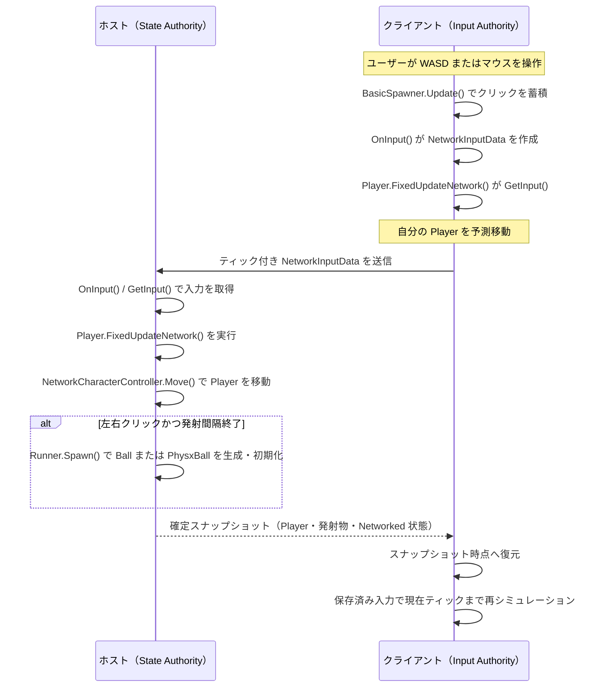

# ホストモードにおける入力共有と予測

このプロジェクトは Photon Fusion のホストモードで動作します。ホストはサーバーとしても動作し、全てのネットワーク状態を確定する **State Authority** を持ちます。一方、各参加者は自分の操作を入力として送信し、手元では先行してシミュレーションすることで、通信遅延中にも即座に操作結果を表示します。

本書は [Fusion の「3 - 予測」](https://doc.photonengine.com/ja-jp/fusion/v2/tutorials/host-mode-basics/3-prediction) と、現在のプロジェクトの実装を対応付けて説明します。

## 登場するオブジェクトと責務

| オブジェクト | 役割 |
| --- | --- |
| `BasicSpawner` | `NetworkRunner` を作成し、`OnInput()` でキーボード・マウスの生入力を `NetworkInputData` に詰める。ホストでは参加時の `Player` の生成も行う。 |
| `NetworkInputData` | ティック単位で共有する入力データ。`Direction` に WASD の移動方向、`Buttons` に左右マウスボタンの押下を格納する。 |
| `Player` | 各プレイヤーのアバター。`GetInput()` で自分に対応する入力を取得し、移動をシミュレーションする。ホスト上では発射物も生成する。 |
| `NetworkCharacterController` | `Player` に付属する移動コンポーネント。`Player.FixedUpdateNetwork()` から `Move()` を呼ばれ、アバターの位置に作用する。 |
| `Ball` / `PhysxBall` | ホストが生成する発射物。`Ball` はキネマティックに直進し、`PhysxBall` は `Rigidbody.linearVelocity` に初速を与える。どちらも寿命終了時にホストが削除する。 |

`BasicSpawner.StartGame()` は `NetworkRunner.ProvideInput = true` を設定します。この設定により、Fusion は各シミュレーションティックで `INetworkRunnerCallbacks.OnInput()` を呼び出し、そのピアが提供する入力を収集します。

## ユーザー入力が伝わる経路

`BasicSpawner.Update()` は毎フレーム、左クリックと右クリックを `_mouseButton0` / `_mouseButton1` に蓄積します。短いクリックが `OnInput()` の呼び出し間隔に収まっても失われないよう、押下を一度記録してから入力データに移し、フラグをリセットしています。

`OnInput()` では次の値を `NetworkInputData` に格納し、`input.Set(data)` で Fusion に渡します。

- **WASD**: `Direction` に前後左右のベクトルを加算する。
- **左クリック**: `Buttons` の `MouseButton0` ビットを立てる。
- **右クリック**: `Buttons` の `MouseButton1` ビットを立てる。

Fusion はこの入力をティックと対応付けます。クライアントが作った入力はホストへ送られ、ホストはそのティックをシミュレーションするときに同じ入力を取り出します。ホスト自身の入力も同じ `OnInput()` → `NetworkInputData` → `GetInput()` の経路を通るため、ゲームロジックは「ローカル操作かリモート操作か」を分岐せずに扱えます。

## ホストとクライアントの通信シーケンス

次の図では、ホストを左、クライアントを右に配置しています。`Player` の移動はクライアントで予測されますが、ネットワーク上の確定状態と `Ball` / `PhysxBall` の生成はホストが担当します。

## `Player` に作用する入力

`Player.FixedUpdateNetwork()` は `GetInput(out NetworkInputData data)` に成功した場合だけ、そのティックの入力を使います。`Direction` は正規化された後、次の形で `NetworkCharacterController` に渡されます。

`_cc.Move(MoveSpeed * data.Direction * Runner.DeltaTime)`

つまり、WASD は **入力を送ったプレイヤーの `Player` オブジェクト**に付属する `NetworkCharacterController` の移動に作用します。移動方向がゼロでなければ `_forward` に保存され、後の発射方向にも使用されます。

クライアントでは、自分の `Player` に対する入力を受信待ちせずに予測シミュレーションできます。ホストからのスナップショットを受信すると、Fusion はネットワーク状態をそのスナップショットのティックへ戻し、保存済みの入力を使って現在ティックまで再シミュレーションします。予測がホストの結果と異なれば、この再シミュレーションによって表示が確定状態へ収束します。

## マウス入力と発射物

クリックを受け取った `Player` は、まず `_delay`（`TickTimer`）で 0.5 秒の発射間隔を確認します。ただし、発射処理は `HasStateAuthority` が真のとき、すなわちホスト上でのみ実行されます。

- **左クリック**: `Runner.Spawn()` で `Ball` を生成する。`Ball.Init()` が 5 秒の寿命を設定し、`Ball.FixedUpdateNetwork()` が `transform.position` を前方へ進める。
- **右クリック**: `Runner.Spawn()` で `PhysxBall` を生成する。`PhysxBall.Init()` が前方ベクトルに `BallSpeed` を掛け、`Rigidbody.linearVelocity` に設定する。

生成時には操作したプレイヤーの `Object.InputAuthority` も発射物へ渡されます。しかし、生成を許可するのは State Authority だけです。そのため、クライアントがクリックした場合でも、クライアント自身が発射物を確定生成するわけではありません。入力がホストに到着し、ホストの `Player.FixedUpdateNetwork()` が `Runner.Spawn()` を実行して初めて発射物がネットワークオブジェクトになります。その生成結果・位置・寿命はスナップショットで全ピアに配信されます。

このように、**入力は各ユーザーが提供し、応答性はクライアント予測で確保し、最終的な状態とオブジェクト生成はホストが確定する**ことで、ホストモードの通信と整合性が成立しています。